# TiXing · 题小星

A local-first question-bank workbench that runs without a network.

Bring your own Excel, CSV, JSON, Word, TXT or Markdown files, then practise, study, run timed exams, review mistakes,
build printable papers and move a full backup between devices. No account, no hosted bank,
no telemetry.

[English](README.md) · [简体中文](README.zh-CN.md)

Android APK and SHA-256 checksums are on [Releases](https://github.com/badhope/ti-xing-offline-ai-practice/releases/latest).

<p align="center">
  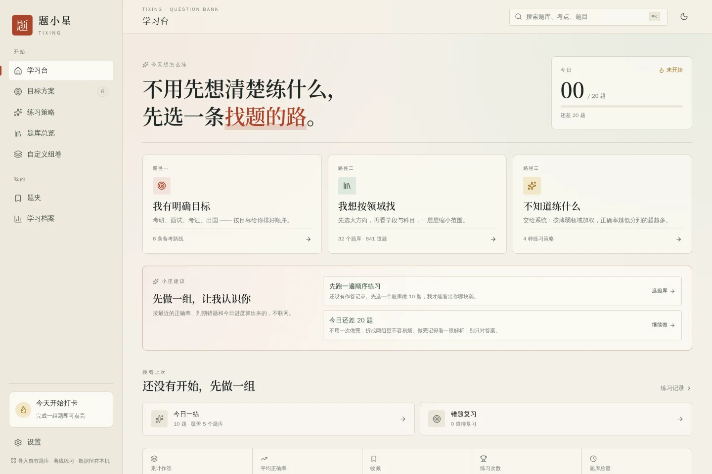
</p>

## What “AI” means here

This build does **not** ship model weights and does not send questions to a cloud API.
“AI” is two separate things:

- **小星建议 (local study coach)**: deterministic rules in `src/lib/coach.ts`. It reads
  practice history, due wrong questions and today’s volume, then suggests what to do next.
  It runs offline and can explain every recommendation.
- **问小星 (optional local tutor)**: an explanation panel in the answer view. When enabled,
  it sends only the current question, options, answer and explanation to an Ollama /
  llama.cpp server on `127.0.0.1`. It is off by default, rejects non-loopback endpoints and
  falls back to the bundled explanation when the model is unavailable. Grading, wrong-book
  archiving and FSRS scheduling never go through the model.

You start the model yourself; no weights are bundled in the APK. Boundaries, CORS, Android
loopback and known limits are documented in [docs/LOCAL_AI.md](docs/LOCAL_AI.md).

<p align="center">
  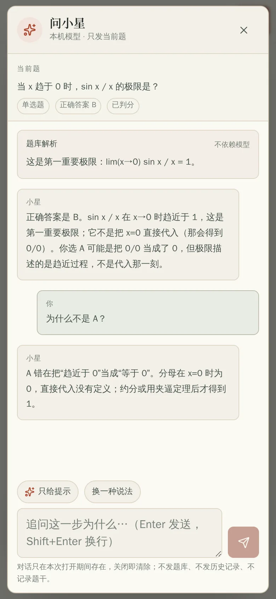
  <br><sub><b>问小星</b> — bundled explanation first, local-model follow-up (UI sample)</sub>
</p>

## Built-in question banks

The app ships with **32 collections and 641 questions** across seven domains: K12, university, professional certificates, languages, coding, public fundamentals and general knowledge. Every collection has at least 20 questions, so the app is usable immediately without importing anything.

These are bundled practice questions, not a hosted bank for sale. You can hide them in Settings, or strip them from the bundle at build time with `VITE_BARE_CONTENT=1`; white-label and corporate builds then contain no bundled stems at all.

## What it does

| | |
| --- | --- |
| **Tolerant import** | Excel (`.xlsx`), JSON, CSV, Word (`.docx`), TXT, Markdown and `.tixing.json` packages. CSV handles BOMs, unquoted `B,D` answers and data URIs split by commas; text imports follow a numbered template and handle single choice, multiple choice, true/false, fill-in and short answer, reporting skipped rows. |
| **Three ways to find questions** | Follow a goal track, drill down by domain, or let the strategy pick from weak areas. |
| **A complete practice loop** | Single choice, multiple choice, true/false, fill-in and short answer. Instant feedback in practice mode; countdown and auto-submit in exam mode; study mode reveals answers first without polluting accuracy. Fill-in answers are matched against configured alternatives; short answers require every grading keyword to appear, and the UI says so instead of pretending to be a semantic grader. |
| **Mistakes do not vanish after one correct answer** | Wrong answers enter the wrong-book; FSRS schedules the next review, with a seven-day due forecast. Tag why you missed it (concept, method, carelessness, time) and keep a short note. |
| **Local study coach** | The home screen says what to do today: weak domain, due mistakes, or keep the current pace. |
| **Optional local tutor** | Connect Ollama / llama.cpp; only the current question is sent. Off by default, with fallback to the bundled explanation. |
| **Edit and roll back** | Edit stems, options, answers and explanations in place. Every save archives the previous version; the last 20 revisions are kept. |
| **Share without a cloud** | Export a password-protected `.tixing.enc.json`, or start a one-time LAN download from the desktop app. No account, no relay. |
| **Stays fast on big banks** | Inverted search index plus progressive card rendering, so a few thousand cards do not hit the DOM at once. |
| **Print a real paper** | A4 layout with name/score fields and optional answers; navigation hides when printing. |
| **One codebase, three shells** | Web/PWA, desktop (Tauri 2) and Android (Capacitor 8) share the same data model. |

The competitor matrix and the boundaries of what TiXing deliberately does not build are in [docs/COMPETITORS.md](docs/COMPETITORS.md).

## Screens

<table>
<tr>
<td width="50%">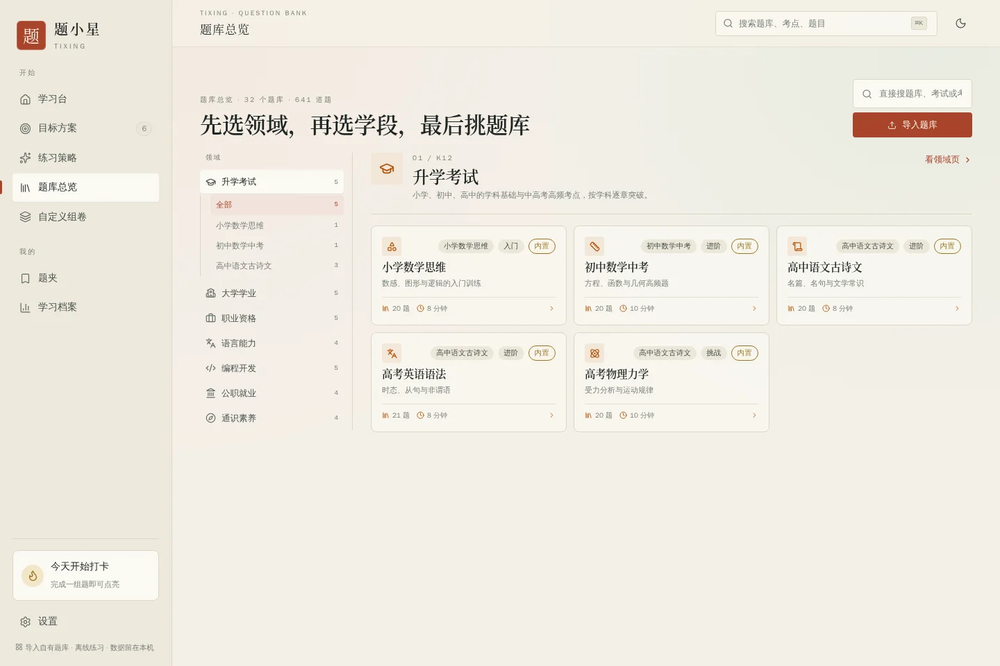<br><sub><b>Catalogue</b> — domain tree, stage filters, bank cards</sub></td>
<td width="50%">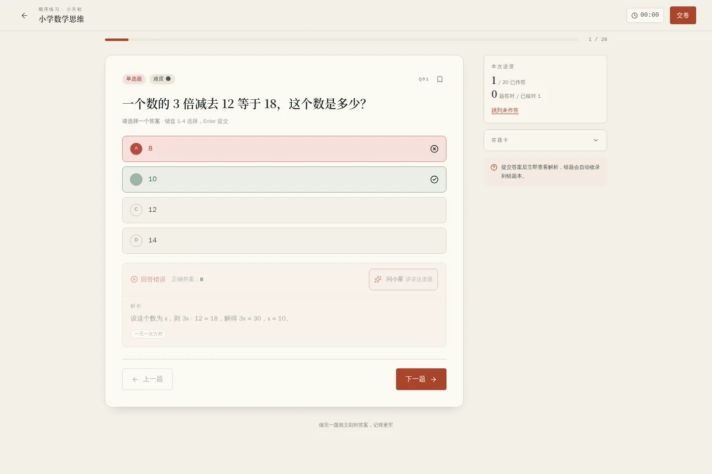<br><sub><b>Practice</b> — instant marking with explanations</sub></td>
</tr>
<tr>
<td width="50%">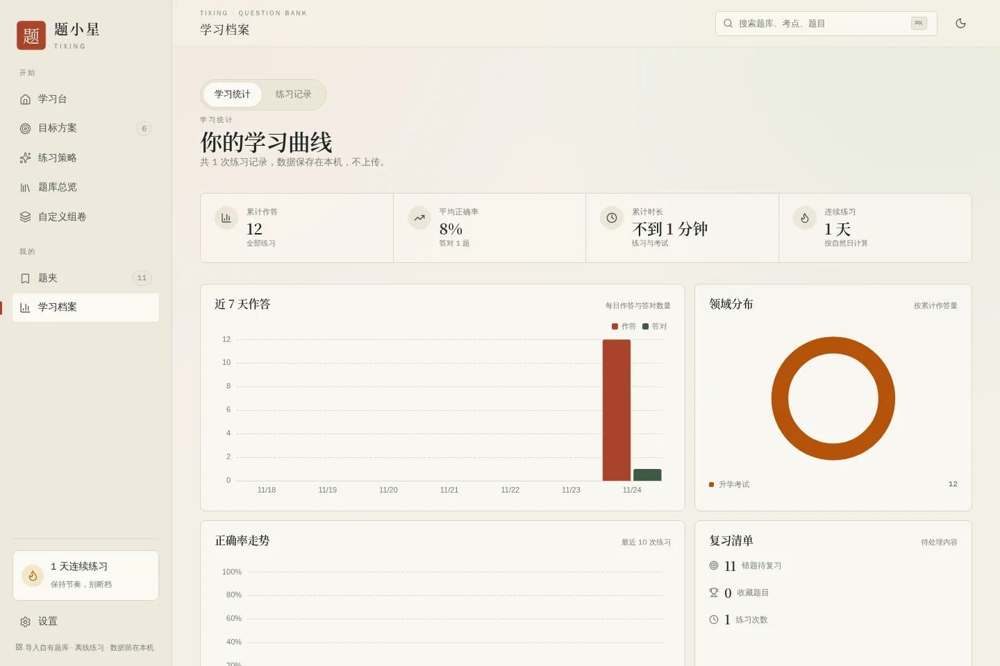<br><sub><b>Statistics</b> — volume, accuracy trend, domain split</sub></td>
<td width="50%">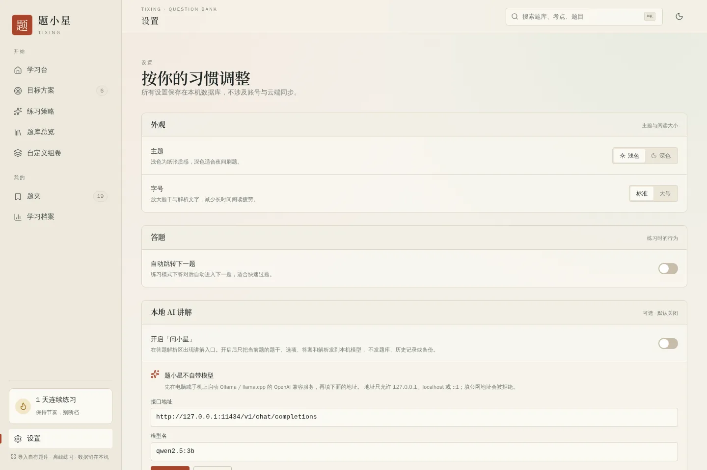<br><sub><b>Settings</b> — backup, restore and preferences</sub></td>
</tr>
<tr>
<td width="50%">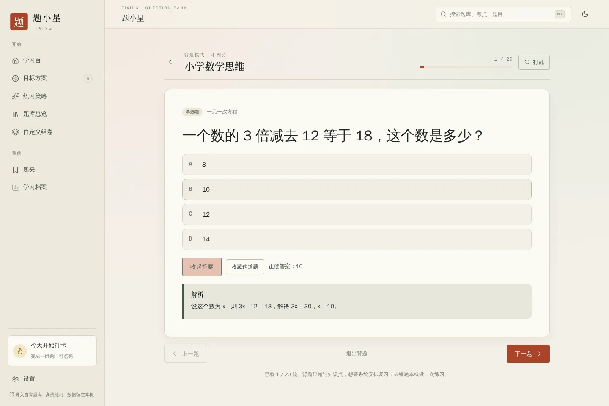<br><sub><b>Study</b> — read answers first, no scoring or accuracy side effects</sub></td>
<td width="50%">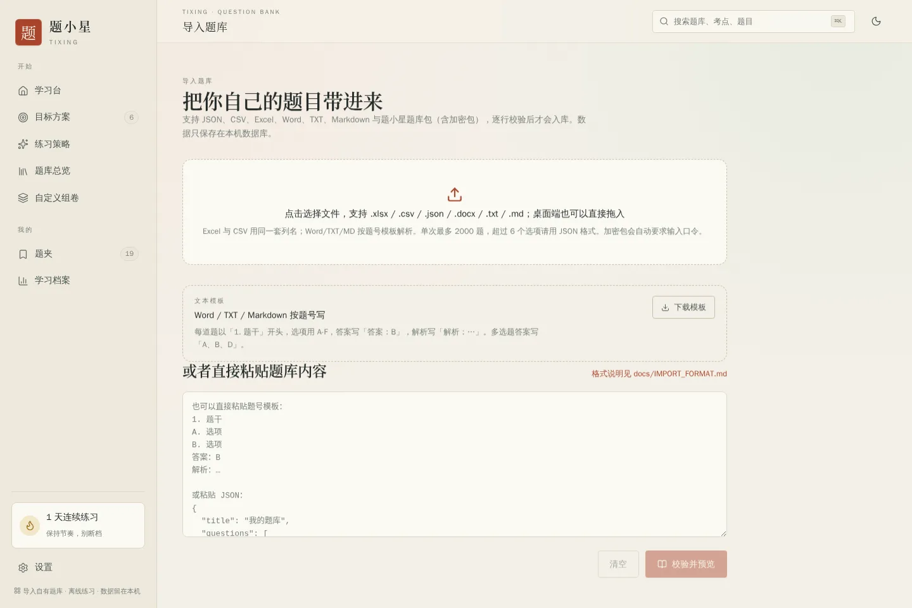<br><sub><b>Import</b> — Word/TXT/MD template or paste directly</sub></td>
</tr>
<tr>
<td width="50%">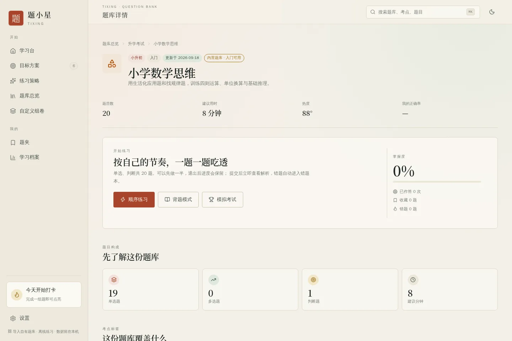<br><sub><b>Bank detail</b> — type mix, study and practice entry points</sub></td>
<td width="50%">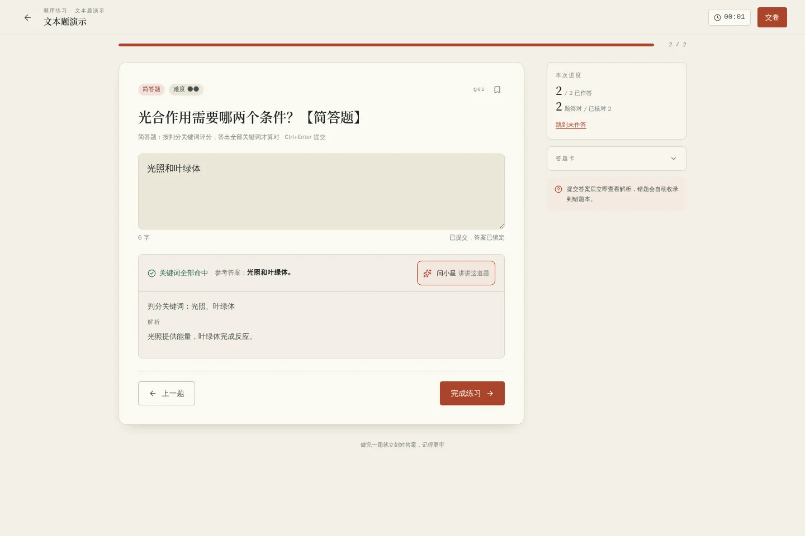<br><sub><b>Fill-in / short answer</b> — text input, keyword hit and reference answer</sub></td>
</tr>
</table>

## On a phone

The same build runs in a 320 px browser and in the Android shell. The layouts below are captured at 390×844 with touch input, not scaled-down desktop screenshots.

<table>
<tr>
<td width="50%">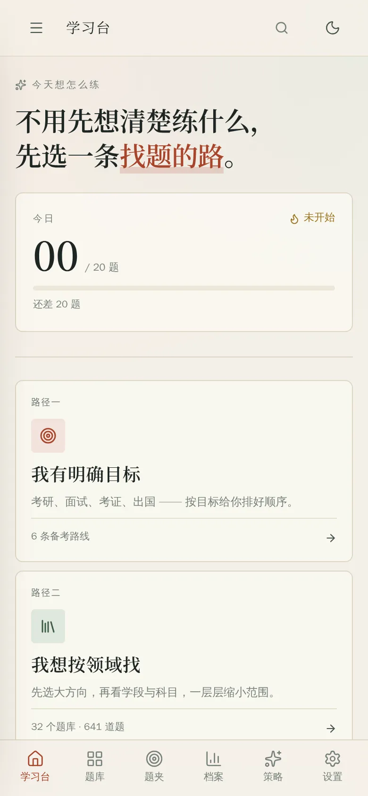<br><sub><b>Learning desk</b> — one path per screen, six-item bottom bar</sub></td>
<td width="50%">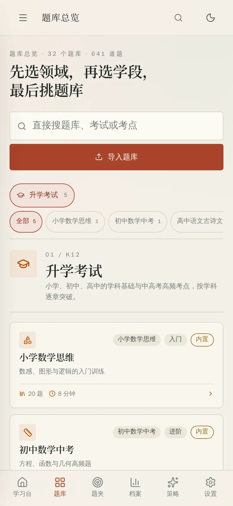<br><sub><b>Catalogue</b> — full-width search and import, scrollable stage chips</sub></td>
</tr>
<tr>
<td width="50%">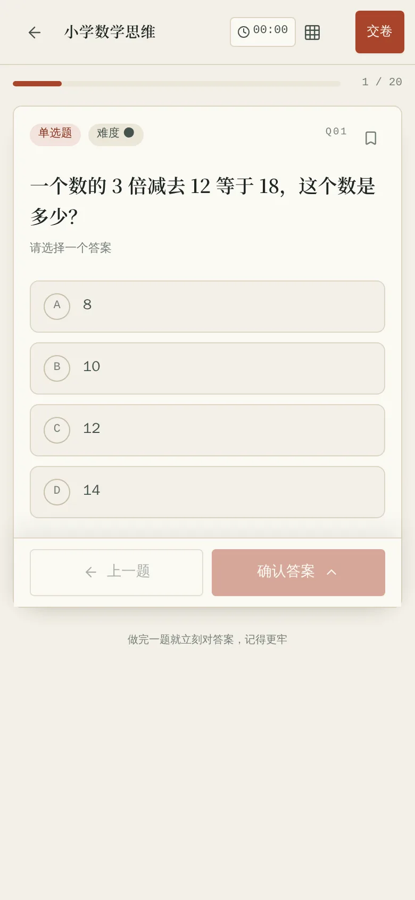<br><sub><b>Practice</b> — single-line header, sticky answer bar</sub></td>
<td width="50%">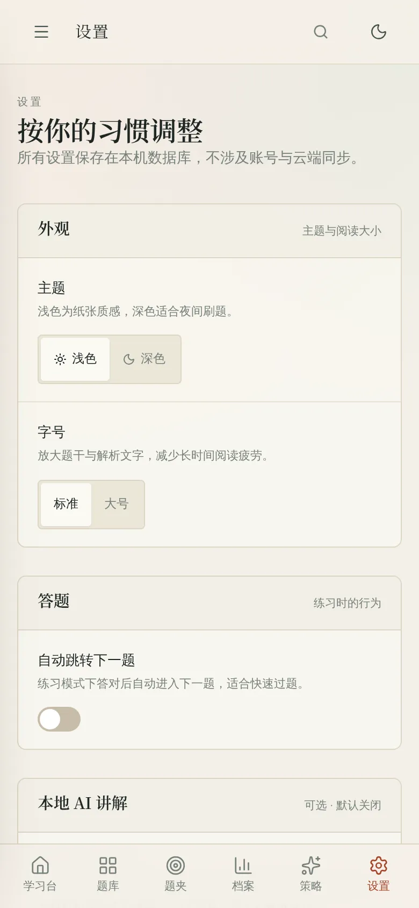<br><sub><b>Settings</b> — stacked rows, native share for backup</sub></td>
</tr>
<tr>
<td width="50%">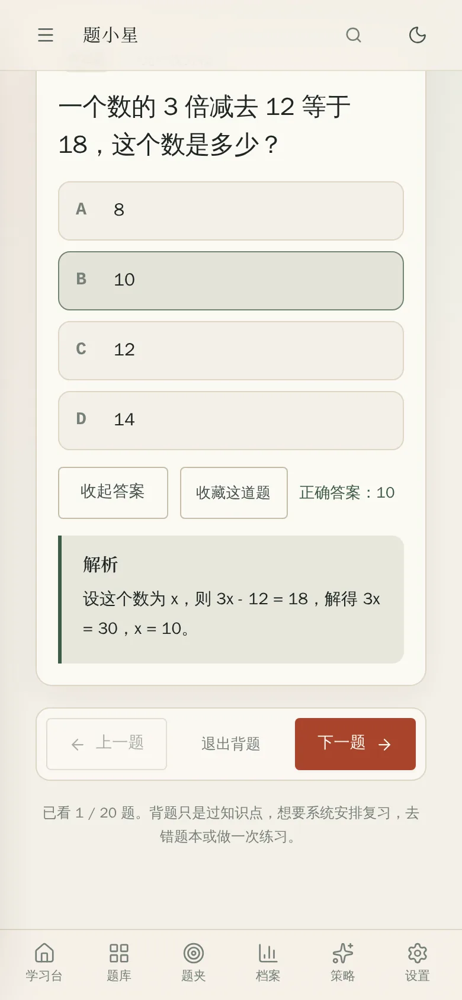<br><sub><b>Study</b> — answer, explanation and navigation on one screen</sub></td>
<td width="50%">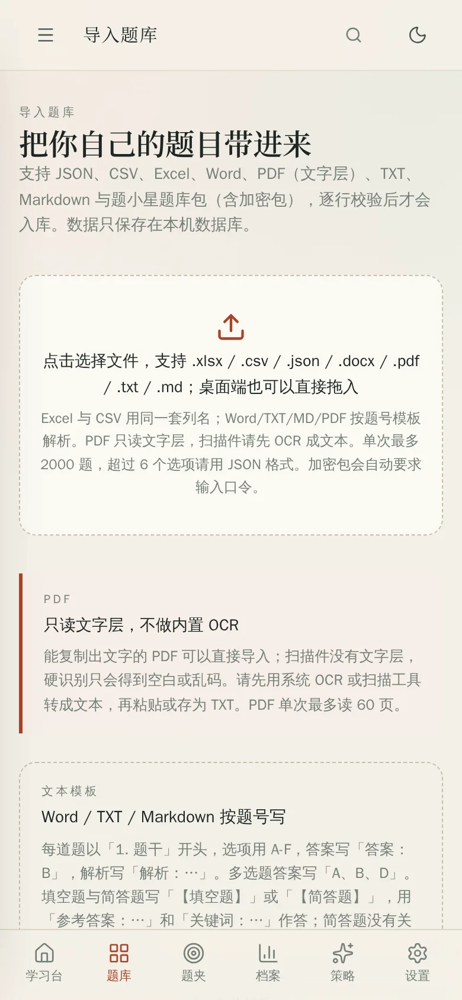<br><sub><b>Import</b> — file, template and paste stacked</sub></td>
</tr>
<tr>
<td width="50%">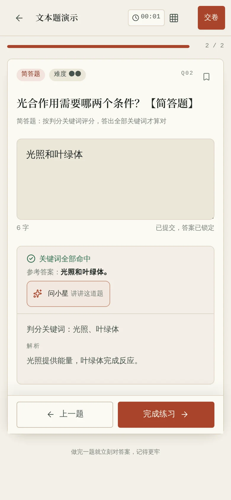<br><sub><b>Text question</b> — keyword hit, reference answer and explanation on one screen</sub></td>
<td width="50%"><br><sub><b>Tutor</b> — local model in the explanation area</sub></td>
</tr>
</table>

Mobile-specific handling is not just CSS:

- **320–430 px** layouts keep 44 px touch targets, avoid whole-page horizontal overflow, and move answer actions into a sticky bottom bar.
- **Notch and gesture area** use Capacitor `SystemBars` CSS insets with an `env(safe-area-inset-*)` fallback; the top bar, bottom nav, sheets and dialogs all reserve the same safe area.
- **Soft keyboard** uses `adjustResize` plus `interactive-widget=resizes-content`; fixed search sheets stay inside the shrunken viewport and inputs use a 16 px minimum to avoid iOS/WebView zoom.
- **Android back** is handled inside the app: close search/sidebar/dialog/answer sheet or confirm leaving a practice before touching WebView history and `App.exitApp()`.
- **File export** on Android writes to the app cache and opens the system share/save sheet through `@capacitor/filesystem` and `@capacitor/share`; a WebView `a[download]` is not assumed to work.

Refresh the phone screenshots with `pnpm preview` running, then `pnpm capture:mobile` (390×844 @2x PNGs in a temp directory).

## Quick start

Requires **Node 20.19+ or 22.12+** and **pnpm**.

```bash
pnpm install
pnpm dev          # http://localhost:5173
pnpm build        # production build with PWA manifest and service worker
pnpm preview      # serve dist/ at http://localhost:4173
```

### Build for every shell

```bash
pnpm build                  # Web / PWA — deploy dist/ to any static host
pnpm desktop:build          # native installer; needs Rust and platform toolchain
pnpm build:apk:release      # signed APK; needs android/keystore.properties
pnpm build:aab:release      # signed AAB for stores that accept it
```

Native shells use hash routing and disable the service worker; the web build uses browser
history routing. All shells depend on the same `src/services/repository.ts` interface.

## Import formats

The shortest path is a CSV with five required columns:

```csv
title,stem,optionA,optionB,optionC,optionD,answer,explanation,type
小学数学,一个数的 3 倍减去 12 等于 18，这个数是多少,8,10,12,14,B,设该数为 x，则 3x - 12 = 18,single
小学数学,下列哪些是偶数,1,2,3,4,B;D,能被 2 整除的整数是偶数,multiple
```

Accepted answers: `B`, `BC`, `B;D`, `B,D`, `B、D`, `B/D`, or 1-based indexes like `1,3`.
Only `stem`, `optionA`, `optionB`, `answer` and `explanation` are required. For fill-in and short-answer rows, leave the option cells and `answer` blank, put the reference answer in `answerText`, and add `keywords` for short answers.

Text and Word imports use the numbered template. Mark a question with `【填空题】` and `答案：…`, or `【简答题】` with `参考答案：…` and `关键词：…`. Short answers are graded by requiring every keyword to appear; this is not a semantic score.

Full field reference: [docs/IMPORT_FORMAT.md](docs/IMPORT_FORMAT.md).

## Where the data lives

| Runtime | Engine | Location |
| --- | --- | --- |
| Desktop (Tauri 2) | SQLite via Rust `rusqlite` | app data dir, `com.tixing.offline.ai/tixing.db` |
| Web / PWA / Android (Capacitor) | IndexedDB | site storage, database `tixing` |

The desktop file is a plain SQLite database. Settings → *Local database* shows the live driver
and exact path.

**Back up before cleaning browser data or uninstalling.** Settings → *Full backup and restore*
exports one JSON containing banks, mistakes, favourites, sessions, papers and preferences.

## Rebrand notes and pitfalls

These are from the actual migration, not a generic checklist:

1. **`namespace` is not `applicationId`.** `namespace` only controls the Java/Kotlin package and
   resource namespace; `applicationId` is the install identity. This build uses a new
   `applicationId`, so old app data is not inherited. The two packages can coexist on one phone.
   Export a backup before switching.
2. **Changing the Tauri `identifier` moves the SQLite directory.** The database does not follow
   automatically; treat it as a new app-data directory.
3. **`android/app/src/main/assets/capacitor.config.json` is generated.** It is ignored by
   `android/.gitignore` and will be overwritten by `npx cap sync android`. Edit the root
   `capacitor.config.ts`, then sync.
4. **History rewriting breaks PR and tag references.** All old-brand names in this repository’s
   history were replaced, so every commit hash changed; old PR commit links and tags point to
   different objects. Do not do this on a shared branch without coordinating, and ordinary
   renames do not need it.
5. **Changing an alias keeps the certificate; changing the brand does not.** The release
   certificate still said `CN=QuizChest`, so 2.0.1 uses a regenerated keystore. Its SHA-256 is
   `98e19402…999e`; the old one is backed up outside the repo. Keep the new keystore and
   passwords offline.
6. **The IndexedDB name changed.** Old WebView data belongs to a different database and app
   identity; export from the old build and import into this one if you need it.

## Platform notes

- Android `minSdk 24` (7.0), `targetSdk 36`; this environment compiled and verified the APK with
  Linux + JDK 21 + Android SDK 36, but **did not run a real-device first launch**.
- Web critical paths are tested in Playwright Chromium; Safari/iOS WebView is untested.
- Desktop was checked with `cargo check`, `cargo test` and `tauri build --no-bundle` on Linux;
  Windows NSIS/MSI installers need a Windows build host.
- Keep a single import under 2,000 questions. Larger banks still work, but preview and first
  index build get noticeably slower.

## Architecture

```
src/
├─ data/        taxonomy, built-in banks, question seeds, record types
├─ services/    data layer: SQLite / IndexedDB / memory drivers
├─ lib/         grading, stats, import/export, strategy, papers, coach
├─ hooks/       session state, timers, brand, service worker, data-layer status
├─ store/       Zustand state with startup hydrate and async persistence
├─ components/  layout, question runner, charts, UI primitives
├─ pages/       route-level screens
└─ styles/      design tokens, layout, page and practice styles
```

A few decisions:

- **Grading and scheduling are pure functions.** `src/lib/quiz.ts` only sees questions and
  selections; `src/lib/review.ts` only sees FSRS state. Unit tests do not need a browser.
- **Failed writes stay visible.** Writes update memory first, then persist; a failure lands in
  `persistenceError` and appears in the top banner and Settings. The UI never pretends a save
  succeeded.
- **The data layer is swappable.** Pages depend on the `Repository` interface; desktop uses
  SQLite, Web/Android use IndexedDB, tests use memory.
- **Search indexes are cached by bank-array identity.** A `WeakMap` drops the index automatically
  when the bank snapshot changes.

More migration and build notes: [docs/DEVLOG.md](docs/DEVLOG.md).

## Quality gates

```bash
pnpm check        # version → typecheck → lint → unit tests → build → cargo test → audit
pnpm test:e2e     # Playwright, real browser, critical paths
pnpm test:e2e:apk # Playwright against the real APK assets, Pixel 5 viewport
```

Unit tests cover grading, import/export, backup restore, FSRS, strategies, search, both
repository drivers, store persistence and component behaviour. `pnpm check` also runs the Rust
data-layer tests and dependency audit.

## Project

- Version source: `package.json`, propagated by `scripts/sync-version.mjs`.
- Changelog: [CHANGELOG.md](CHANGELOG.md)
- Release process: [docs/RELEASING.md](docs/RELEASING.md)
- Contributing: [CONTRIBUTING.md](CONTRIBUTING.md)
- Security: [SECURITY.md](SECURITY.md)
- License: [MIT](LICENSE.md)
