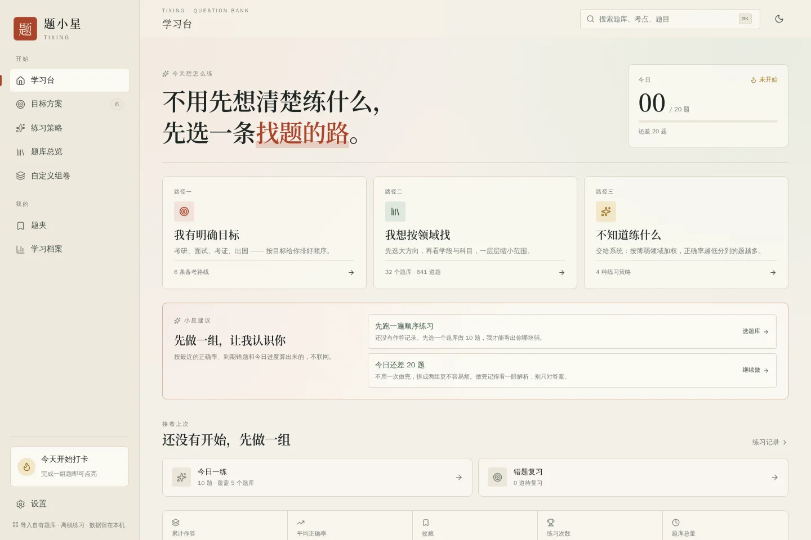
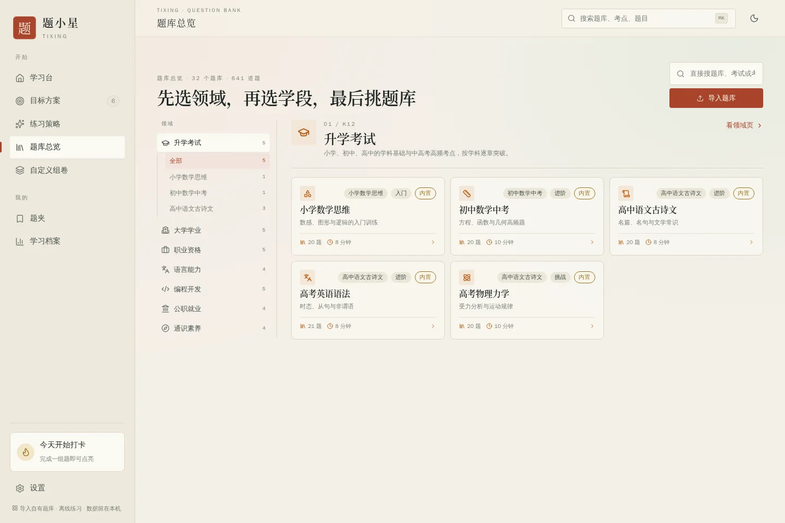
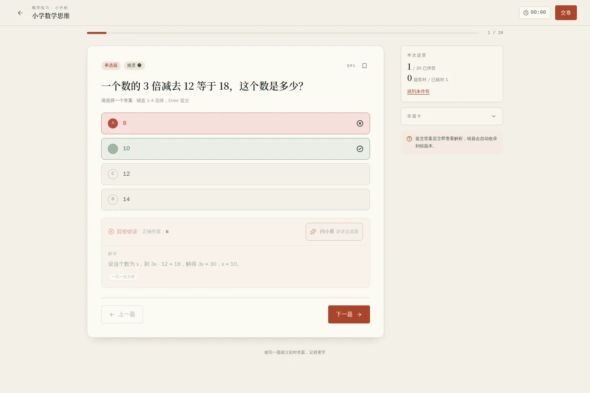
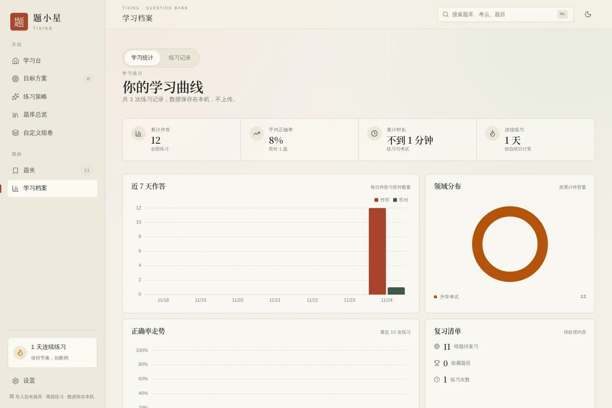
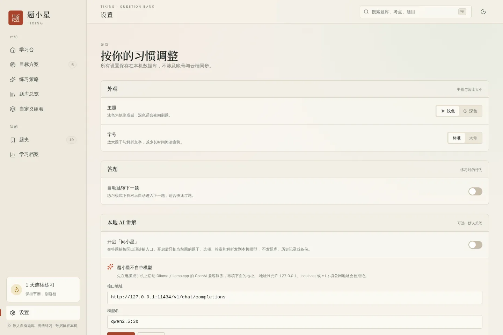

# 题小星 · TiXing

一个不联网也能把题库跑起来的本地工作台。

导入自己的 Excel、CSV 或 JSON，练题、限时考试、错题复习、组卷打印、备份迁移，数据全部留在设备上。
题小星不卖题库、不做账号、不接云端，首页那个「小星建议」也是本地算出来的。

[English](README.md) · [简体中文](README.zh-CN.md)

<p align="center">
  
</p>

## 先说明「AI」这件事

题小星当前**没有内置大模型权重**，也不会把题目发到云端 API。

应用里的「小星建议」是一个纯本地学情引擎：读练习记录、错题到期时间、今日进度，给出「先补哪个领域、先清哪批错题、今天还差几题」这类可解释的建议。它跑在 `src/lib/coach.ts`，不联网、不占内存，也不假装懂题。

以后如果要接本地模型（Ollama、llama.cpp server 或 Android 端的小模型），建议只把它当成「解析增强」，不要把判分、错题归档和复习调度交给模型。判分必须可复现，模型只做讲解和追问。设计边界写在 [docs/LOCAL_AI.md](docs/LOCAL_AI.md)。

## 内置题库

随包带 **32 个题库、463 道题**，覆盖 7 个领域：K12、大学、职业证书、语言、编程、公共基础、通识。每个题库至少 12 题，装好打开就能练，不用先导入。

这些题是随包练习内容，不是拿来卖题库：设置里可以隐藏，也可以用 `VITE_BARE_CONTENT=1` 在构建期整体剥离。做白标或企业内训时，产物里不会出现任何示例题干。

## 它能做什么

| | |
| --- | --- |
| **导入格式够宽容** | Excel（`.xlsx`）、JSON、CSV 与 `.tixing.json` 题库包；CSV 的 BOM、未加引号的 `B,D`、被逗号切开的 data URI 都做了兼容。 |
| **三条找题路径** | 跟目标路线走、按领域逐层钻取，或让策略按薄弱项配题。 |
| **完整练习闭环** | 单选、多选、判断；练习模式即时批改，考试模式倒计时并自动交卷。 |
| **错题不会答对一次就消失** | 答错自动进错题本，FSRS 安排下次复习；到期题优先排，答对多次后再标记掌握。 |
| **小星建议** | 首页直接告诉你今天先干什么：补薄弱领域、清到期错题，或保持节奏。 |
| **题库能改、能回滚** | 题干、选项、答案、解析就地编辑；每次保存前存档，最多保留 20 个历史版本。 |
| **不经过云的分享** | 导出口令加密的 `.tixing.enc.json`，或在桌面端起一次性局域网下载；没有账号和中继。 |
| **大题库不卡** | 搜索走倒排索引，题库卡片渐进渲染，不会一次挂几千张卡到 DOM。 |
| **能印出真正的卷子** | A4 版式、姓名/得分栏、可选答案解析，打印时自动隐藏导航。 |
| **三端一套代码** | Web/PWA、桌面（Tauri 2）、Android（Capacitor 8），共用同一套数据模型。 |

## 界面

<table>
<tr>
<td width="50%"><br><sub><b>题库总览</b> — 领域树、学段筛选、题库卡片</sub></td>
<td width="50%"><br><sub><b>答题</b> — 即时判分并展示解析</sub></td>
</tr>
<tr>
<td width="50%"><br><sub><b>学习统计</b> — 作答量、正确率走势、领域分布</sub></td>
<td width="50%"><br><sub><b>设置与备份</b> — 完整备份、恢复与偏好设置</sub></td>
</tr>
</table>

## 快速开始

需要 **Node 20.19+ 或 22.12+**，包管理器用 **pnpm**。

```bash
pnpm install
pnpm dev          # http://localhost:5173
pnpm build        # 生产构建，含 PWA manifest 与 Service Worker
pnpm preview      # 预览 dist/，http://localhost:4173
```

### 三端构建

```bash
pnpm build                  # Web / PWA，把 dist/ 部署到任意静态托管
pnpm desktop:build          # 桌面安装包，需要 Rust 与系统原生工具链
pnpm build:apk:release      # 签名 APK，需要 android/keystore.properties
pnpm build:aab:release      # 签名 AAB，用于支持 AAB 的商店
```

原生壳使用 hash 路由并关闭 Service Worker；Web 构建使用浏览器 history 路由。
三端共用 `src/services/repository.ts` 这一层接口，换引擎不换页面。

## 导入格式

最快的方式是只写 5 个必需列的 CSV：

```csv
title,stem,optionA,optionB,optionC,optionD,answer,explanation,type
小学数学,一个数的 3 倍减去 12 等于 18，这个数是多少,8,10,12,14,B,设该数为 x，则 3x - 12 = 18,single
小学数学,下列哪些是偶数,1,2,3,4,B;D,能被 2 整除的整数是偶数,multiple
```

答案支持 `B`、`BC`、`B;D`、`B,D`、`B、D`、`B/D`，也支持从 1 开始的下标如 `1,3`。
必填列只有 `stem`、`optionA`、`optionB`、`answer`、`explanation`。

完整字段说明见 [docs/IMPORT_FORMAT.md](docs/IMPORT_FORMAT.md)。

## 你的数据在哪

题小星在设备上自带数据库，不需要服务器：

| 运行形态 | 数据库引擎 | 位置 |
| --- | --- | --- |
| 桌面（Tauri 2） | SQLite（Rust `rusqlite`） | 系统应用数据目录 `com.tixing.offline.ai/tixing.db` |
| Web / PWA / Android（Capacitor） | IndexedDB | 浏览器站点数据 `tixing` |

桌面端数据库是标准 SQLite 文件，可以用任意 SQLite 工具打开。设置页「本地数据库」会显示当前驱动与完整路径。

**清浏览器数据或卸载前先备份。** 设置页「完整备份与恢复」会导出包含题库、错题、收藏、练习记录、组卷与设置的 JSON；换设备导入即可还原。

## 踩坑记录

这些是这次品牌迁移和 Android 打包过程中真踩到的，不是模板：

1. **`namespace` 和 `applicationId` 不是一回事。** `namespace` 只决定 Java/Kotlin 包和资源命名空间；`applicationId` 才是安装身份。这次把 `applicationId` 改成了 `com.tixing.offline.ai`，旧包名的数据不会自动继承，两个包可以在同一台手机上共存。我们不打算做旧数据迁移，升级前请自己导出备份。
2. **Tauri `identifier` 改了，SQLite 目录也会换。** 桌面端数据目录由 identifier 决定，`tixing.db` 不会从旧目录自己跑过来；换 identifier 等于换一个应用数据目录。
3. **`android/app/src/main/assets/capacitor.config.json` 是生成物。** 它被 `android/.gitignore` 排除，直接改会在下一次 `npx cap sync android` 时被覆盖。要改 `appId`/`appName`，改根目录 `capacitor.config.ts`，再 sync。
4. **Git 历史重写会打断 PR 和标签引用。** 这次把全部提交里的旧仓库名/旧包名替换了，commit hash 全变，PR #43 的旧提交关系失效，`v1.8.0`/`v1.9.1` 标签重新指向新历史。公开仓库做这件事之前先确认分支保护允许强推，或者临时关掉再恢复；普通品牌改名不需要重写历史。
5. **改别名不会改证书，换证书要重新生成 keystore。** 这次为了让签名证书里的 `CN=QuizChest` 也换掉，重新生成了 `keystore/tixing-release.jks`；新证书 SHA-256 是 `98e19402…999e`，旧 keystore 已离线备份到 `backups/`。以后必须继续用这份新 keystore，丢了就没法发同签名升级包。
6. **IndexedDB 库名换成了 `tixing`。** 旧库名和新包名都不是同一套身份，所以旧 WebView 数据不会自动出现。需要旧数据就先用旧版导出备份，再到新版导入。

## 机型与环境适配

- Android `minSdk 24`（Android 7.0），`targetSdk 36`；当前只做了 Linux + JDK 21 + Android SDK 36 的编译和 APK 验签，**没有接真机跑首启**。
- Web 端用 Playwright Chromium 跑关键链路；Safari / iOS WebView 未验证。
- 桌面端在 Linux 上跑过 `cargo check` / `cargo test` / `tauri build --no-bundle`；Windows NSIS/MSI 安装包需要在 Windows 上构建。
- 大题库建议 2000 题以内单包导入；超过这个量，导入预览和首次索引会明显变慢，但不会崩。

## 架构

```
src/
├─ data/        分类体系、示例题库、题目种子、数据记录类型
├─ services/    数据层：SQLite / IndexedDB / 内存实现与环境选择
├─ lib/         判分、统计、导入导出、策略、组卷、小星建议
├─ hooks/       会话状态、计时器、品牌、Service Worker、数据层状态
├─ store/       Zustand 状态 + 启动 hydrate 与异步落库
├─ components/  布局、答题器、图表、基础 UI
├─ pages/       路由页面
└─ styles/      设计变量、布局、页面与练习样式
```

几个取舍：

- **判分和调度是纯函数。** `src/lib/quiz.ts` 只认题目和选项，`src/lib/review.ts` 只认 FSRS 状态；这样单测不需要浏览器，也不会因为界面改动把判分改坏。
- **写库失败要看得见。** 写操作先更新内存保证界面响应，失败时把错误写进 `persistenceError`，顶部提示条和设置页都能看到，不假装保存成功。
- **数据层可替换。** 页面只依赖 `Repository` 接口；桌面走 SQLite，Web/Android 走 IndexedDB，测试走内存。
- **搜索索引按题库数组缓存。** 用 `WeakMap` 挂缓存，题库快照一换就自动失效，不用手动清。

更多开发和迁移记录见 [docs/DEVLOG.md](docs/DEVLOG.md)。

## 质量门禁

```bash
pnpm check        # 版本 → 类型 → lint → 单测 → 构建 → cargo test → 依赖审计
pnpm test:e2e     # Playwright，真实浏览器，关键链路
pnpm test:e2e:apk # Playwright 跑在 APK 真实资源上，Pixel 5 视口
```

单测覆盖判分、导入导出、备份恢复、FSRS、策略配题、搜索索引、两个仓储驱动、store 落库与组件行为；`pnpm check` 末尾会跑 Rust 数据层测试和依赖审计。

## 项目管理

- 版本号：`package.json` 是唯一来源，`scripts/sync-version.mjs` 传播到 Tauri、Cargo 与 Android。
- 变更历史：[CHANGELOG.md](CHANGELOG.md)
- 发布流程：[docs/RELEASING.md](docs/RELEASING.md)
- 贡献指南：[CONTRIBUTING.md](CONTRIBUTING.md)
- 安全策略：[SECURITY.md](SECURITY.md)
- 许可证：[MIT](LICENSE.md)
